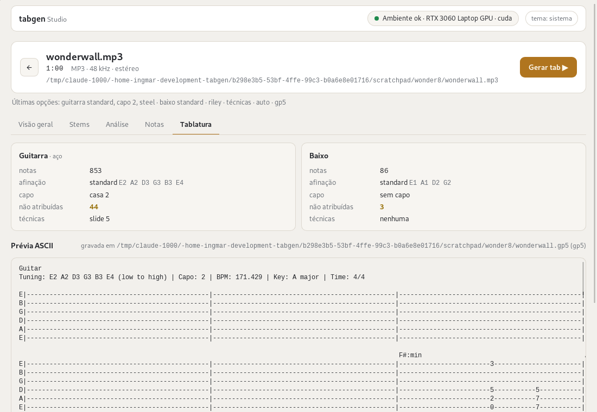

# tabgen

Open source tool that takes a song's audio file and produces editable guitar/bass
tablature: it separates the instruments (electric guitar, acoustic guitar, bass),
detects the key, chords and tempo, and exports the result as Guitar Pro (`.gp5`),
MusicXML, MIDI and ASCII tab — using only free and open models.

tabgen is CLI-first and layered: a pure-Python core library (`tabgen/core`) does
all the work, and thin interfaces consume its API: the CLI and the desktop app
[tabgen Studio](desktop/README.md).

> Status: early development. See [docs/planejamento/audio-para-tablatura.md](docs/planejamento/audio-para-tablatura.md)
> for the full research and planning document (in Brazilian Portuguese).

## How it works

Six-stage pipeline, all stages behind a pure-Python core library:

1. **Source separation** — [Demucs v4](https://github.com/adefossez/demucs) (`htdemucs_ft` + `htdemucs_6s`)
2. **Key + chord detection** — [madmom](https://github.com/CPJKU/madmom)
3. **Beat / downbeat tracking** — madmom `DBNDownBeatTracker` (bar grid + BPM)
4. **Audio-to-notes transcription** — guitar: the CRNN of [Riley et al. 2024](https://arxiv.org/abs/2402.15258)
   (GAPS weights), with pitch bends taken from [Basic Pitch](https://github.com/spotify/basic-pitch);
   bass: Basic Pitch
5. **String/fret assignment** — dynamic programming over fingering costs (configurable tuning)
6. **Quantization + export** — [music21](https://www.music21.org) + [PyGuitarPro](https://github.com/Perlence/PyGuitarPro) (`.gp5`)

## Architecture

```
tabgen/
├── core/        # pure library: no terminal, HTTP or GUI I/O
│   ├── separation/  analysis/  transcription/  fretting/  export/
│   ├── models.py    # serializable dataclasses (stage contracts)
│   ├── cache.py     # on-disk cache of stage results
│   └── pipeline.py  # orchestration, progress via callbacks
├── cli/         # thin layer: the tabgen command
└── worker/      # NDJSON worker (python -m tabgen.worker) used by the desktop app
desktop/         # tabgen Studio: Tauri 2 + React shell over the worker
```

The core never prints or serves HTTP; interfaces are thin consumers of its API,
so the CLI and the desktop app share the pipeline without rewriting it. Stage results are JSON-serializable and cached on disk.

## Requirements

- Linux
- Python 3.10–3.11 (upper bound set by the madmom dependency)
- ffmpeg on the `PATH`
- git and a C compiler (gcc) at install time — madmom is built from source
- NVIDIA GPU with ≥6 GB VRAM recommended; CPU works but is 10–20× slower

## Installation

From a clone of this repository:

```bash
python3.11 -m venv .venv
source .venv/bin/activate
pip install -e ".[dev]"
pip install --no-deps basic-pitch==0.4.0
```

The last step is required: Basic Pitch is installed with `--no-deps` because its
wheel metadata pulls in tensorflow, which forces numpy<2 and conflicts with the
torch stack — tabgen uses its ONNX backend, whose actual dependencies
(onnxruntime, librosa, pretty-midi, ...) are already listed in `pyproject.toml`.
Without this step the `transcribe` command will not work.

**Guitar model weights:** the default guitar transcriber (`riley`, see
[Transcriber](#transcriber)) downloads its weights (`guitar-gaps.pth`, ~99 MB,
pinned revision, sha256-checked) from the Hugging Face hub on first use and keeps
them in the `huggingface_hub` cache (`~/.cache/huggingface`).

**madmom note:** `pip install -e ".[dev]"` installs madmom from a pinned commit
of the [CPJKU/madmom](https://github.com/CPJKU/madmom) GitHub repository (no
extra step needed). The last PyPI release (0.16.1, from 2018) does not build on
Python 3.11 / numpy 2, while upstream HEAD does — without downgrading numpy or
torch. Because it is built from source, git and a C compiler must be available
at install time.

**PyTorch / CUDA note:** the default `pip install torch` (which the command
above runs for you) pulls the CUDA-enabled Linux wheel from PyPI. If you need a
build for a specific CUDA version, install torch from the PyTorch index instead,
e.g.:

```bash
pip install torch --index-url https://download.pytorch.org/whl/cu121
```

(replace `cu121` with the CUDA version you want — see
[pytorch.org](https://pytorch.org/get-started/locally/) for the available tags).

## Desktop app (tabgen Studio)



tabgen Studio is a desktop window over the same pipeline: open an audio file,
pick the options (instruments, tunings, capo, guitar type, transcriber,
techniques, output format), follow each stage's progress, browse the stems,
analysis, notes and tablature, and export Guitar Pro, MusicXML or ASCII.
It runs on Linux as a `.deb` or AppImage and uses the virtual environment
installed above — it does not bundle Python or the models.

```bash
cd desktop
npm install
npm run tauri build   # .deb and AppImage in src-tauri/target/release/bundle/
```

On first launch, open **Ambiente** and set **Interpretador Python** to the
interpreter of that environment (e.g. `/path/to/tabgen/.venv/bin/python`); the
screen lists what is missing when the check fails. Build requirements, sizes
and development mode: [desktop/README.md](desktop/README.md).

## Usage

The examples below use the CLI; the [desktop app](#desktop-app-tabgen-studio)
runs the same pipeline.

Check the installed version:

```bash
tabgen --version
```

Check that your environment can run tabgen (ffmpeg, Python version,
torch + CUDA/GPU, madmom, free disk space). Exit code is 0 when all essential
checks pass:

```bash
tabgen doctor
```

Machine-readable output:

```bash
tabgen doctor --json
```

### Separate a song into stems

```bash
tabgen separate song.mp3
```

Runs Demucs (`htdemucs_ft` + `htdemucs_6s`) and writes
`stems/{vocals,drums,bass,other,guitar}.wav` next to the input. Use
`--device cuda|cpu` to override the autodetected device.

### Transcribe a song to MIDI

```bash
tabgen transcribe song.mp3
```

Runs the full Phase 1 pipeline: separation, then Basic Pitch transcription of
each stem, then MIDI export. It writes one Standard MIDI File per instrument —
`song.guitar.mid` and `song.bass.mid` by default — next to the input (override
with `--output-dir`). Options:

- `--instruments guitar,bass` — comma-separated subset of `guitar`, `bass`.
- `--output-dir DIR` — where the `.mid` files go.
- `--device cuda|cpu` — device for Demucs (default: autodetect).
- `--guitar-type electric|nylon|steel` — General MIDI program of the guitar
  track (default `electric`, program 27; nylon 24, steel 25).
- `--transcriber riley|basic-pitch` — guitar transcription model (default
  `riley`; see [Transcriber](#transcriber)).

Each `.mid` file contains a single track with the detected notes (pitch, onset,
duration, velocity) plus their pitch bends, under a General MIDI program
(clean electric guitar by default / fingered bass). Timestamps are absolute seconds —
no quantization to a bar grid yet (that is a later pipeline stage). The files
open in any MIDI player or editor; [TuxGuitar](https://tuxguitar.app) is the
reference target, since it shows them directly as tablature.

**Caching:** stage results are cached in `.tabgen/` directories next to the
audio files (keyed by content hash, model and parameters). Re-running a command
on an unchanged input reuses the cache and finishes in under a second — delete
the `.tabgen/` directories (and `stems/`) to force a re-run.

### Analyze a song (key, tempo, chords)

```bash
tabgen analyze song.mp3
```

Runs the Phase 2 pipeline: separation (reusing the cache when warm), then
madmom beat/downbeat tracking on the original audio and key/chord recognition
on a drum-free mix of the stems. It prints a report and writes
`song.analysis.json` next to the input (override with `--output`):

```text
Key: F# major (confidence 0.86)
Tempo: 139.5 BPM (580 beats, 145 downbeats)
Chords:
     1.60s -    5.30s  F#:maj
     5.30s -    8.80s  B:maj
     8.80s -   12.20s  D#:min
     ...
```

Chord labels use the [Harte](https://ismir2005.ismir.net/proceedings/1080.pdf)
syntax (`F#:maj`, `D#:min`, `N` for no chord). The JSON file is an
`AnalysisResult` (key, confidence, BPM, beat/downbeat times, chord segments)
that later pipeline stages consume. Options:

- `--output FILE` — where the JSON report goes.
- `--device cuda|cpu` — device for Demucs (default: autodetect).

### Generate tablature (Guitar Pro, MusicXML, ASCII)

```bash
tabgen export song.mp3 -o song.gp5
```

Runs the whole pipeline: separation, analysis (key, beats, chords),
transcription of the guitar and bass stems, a cross-check of the key against
the transcribed notes, quantization on the detected bar grid and string/fret
assignment by dynamic programming, then playing-technique detection. The
result is one file with a guitar and a
bass track — tuning, BPM, key signature and chord names included — that opens
in [TuxGuitar](https://tuxguitar.app) or Guitar Pro. The output suffix picks
the format:

- `.gp5` — Guitar Pro 5, the main target (string/fret, durations, ties).
- `.musicxml` / `.xml` — MusicXML via music21 (notes carry string/fret marks).
- `.txt` — plain ASCII tab, e.g.:

```text
Guitar
Tuning: E2 A2 D3 G3 B3 E4 (low to high) | BPM: 139.535 | Key: F# major | Time: 4/4

  F#:maj
E|------------------------------------------------|
B|------------------------------------------2-----|
G|------------------------------------------------|
D|3--4-----4-----4-----4-----4--------4-----4-----|
A|---4--------------4--------4--------4--------4--|
E|---2-----------2--2--------------2--2-----2-----|
```

Options:

- `-o FILE` — output file (default: `<input>.gp5` next to the input).
- `--format gp5|musicxml|ascii` — force the format regardless of the suffix.
- `--instruments guitar,bass` — comma-separated subset of `guitar`, `bass`.
- `--tuning` — guitar tuning: a preset (`standard`, `drop-d`,
  `half-step-down`, `d-standard`) or notes low-to-high, e.g.
  `D2,A2,D3,G3,B3,E4`.
- `--bass-tuning` — bass tuning: a preset (`standard`, `drop-d`,
  `half-step-down`, `five-string` = B0 E1 A1 D2 G2) or notes low-to-high, e.g.
  `E1,A1,D2,G2`. Five notes make a 5-string bass track.
- `--guitar-type electric|nylon|steel` — guitar kind: General MIDI program
  (27 / 24 / 25) and highest usable fret (24 / 19 / 20). Default `electric`.
- `--capo N` — guitar capo fret (frets in the tab are relative to it).
- `--techniques` / `--no-techniques` — detect and write playing techniques
  (default on; see below).
- `--transcriber riley|basic-pitch` — guitar transcription model (default
  `riley`).
- `--device cuda|cpu` — device for Demucs (default: autodetect).

The tablature is cached in `.tabgen/` per input, tuning, capo, guitar type,
transcriber and techniques switch: re-exporting the same song to another format
finishes in under a second. Notes outside the instrument's range are left out
and counted in the report. Frets above 12 cost more in the string/fret
assignment, so sparse lines stay in the lower positions.

#### Playing techniques

With techniques on (the default), tabgen marks:

- **bends** and **slides** — from the pitch-bend curves Basic Pitch reports for
  each note (bend: at least 3/4 of a semitone; slide: a glide of at least one
  semitone into the next note on the same string);
- **hammer-ons** and **pull-offs** — notes on the same string that follow
  each other with no gap and a weak onset.

They are written as note effects in `.gp5` and MusicXML. In ASCII tab they read
`7b9` (bend from 7 to 9), `5/7` and `7\5` (slide up / down), `5h7` (hammer-on)
and `7p5` (pull-off); when a bend widens the columns the marks are padded with
`-` (e.g. `5h--7`). Palm mute and vibrato are not detected.

#### Transcriber

The guitar stem is transcribed by the CRNN of Riley et al. (["High Resolution
Guitar Transcription via Domain Adaptation"](https://arxiv.org/abs/2402.15258),
ICASSP 2024, trained on [GAPS](https://arxiv.org/abs/2408.08653)); the network
is re-implemented in `tabgen/core/transcription/riley.py` from the MIT code of
Kong et al. That model reports no pitch bends, so Basic Pitch also runs on the
guitar stem and each note takes the bends of the matching Basic Pitch note
(same pitch, onset within 50 ms). `--transcriber basic-pitch` restores the
previous, Basic-Pitch-only transcription. The bass is always transcribed by
Basic Pitch. See [docs/avaliacao/modelo-guitarra.md](docs/avaliacao/modelo-guitarra.md)
for the comparison that made `riley` the default.

**What to expect.** The output is an **editable draft, not a finished
score**: Basic Pitch reaches roughly 66% F-measure on real recordings, and
audio-to-tab state of the art is around 54% end to end. Always review the tab
in TuxGuitar or Guitar Pro before using it (true of commercial tools too).

- Works best with a clean mix, a prominent guitar, little distortion and a
  steady tempo.
- Struggles with heavy distortion, several instruments in the same register,
  rubato and unusual tunings that were not passed with `--tuning`.
- Acoustic and electric guitar in the same mix are not told apart: the guitar
  stem is treated as one track (`--guitar-type` only sets its sound and fret
  range).
- Techniques are heuristic: expect missed and spurious bends, slides and
  hammer-ons, especially on distorted guitar.
- The string/fret assignment still favours the lower strings; the evaluation
  below measures string accuracy (tab-F1) well under note accuracy.

### Evaluation

`scripts/eval/run.py` scores the pipeline on a fixed, versioned subset of
[GuitarSet](https://guitarset.weebly.com) (8 excerpts, mono mic) and
EGDB (8 clips, DI) —
datasets are kept outside the repository and downloaded only with
`--download --yes`. Note-F1 matches onset (±50 ms) and pitch (±50 cents);
tab-F1 also requires the right string. EGDB tab-F1 covers the 5 clips whose
annotation carries strings.

| Input | Transcriber | GuitarSet note-F1 / tab-F1 | EGDB note-F1 / tab-F1 |
| ----- | ----------- | -------------------------- | --------------------- |
| clean guitar | basic-pitch | 0.761 / 0.341 | 0.765 / 0.418 |
| clean guitar | riley       | 0.892 / 0.453 | 0.860 / 0.486 |
| Demucs stem of a mix | basic-pitch | 0.745 / 0.334 | 0.615 / 0.224 |
| Demucs stem of a mix | riley       | 0.879 / 0.472 | 0.691 / 0.336 |

Commands (one row each; `$d` is `guitarset` or `egdb`):

```bash
.venv/bin/python scripts/eval/run.py --dataset $d --subset scripts/eval/subsets/$d.txt
.venv/bin/python scripts/eval/run.py --dataset $d --subset scripts/eval/subsets/$d.txt --transcriber riley
.venv/bin/python scripts/eval/run.py --dataset $d --subset scripts/eval/subsets/$d.txt --mix
.venv/bin/python scripts/eval/run.py --dataset $d --subset scripts/eval/subsets/$d.txt --mix --transcriber riley
```

The harness default is still `basic-pitch`, so the main reports
(`scripts/eval/reports/<dataset>-<subset>.md`) stay the Basic Pitch baseline;
`--transcriber riley` reports go to `scripts/eval/reports/riley/` and `--mix`
reports to `scripts/eval/reports/mixed/<transcriber>/`. The mix mode adds bass
and drums from the [MUSDB18](https://sigsep.github.io/datasets/musdb.html)
7-second test excerpts (CC BY 4.0, `--musdb-dir`) at the guitar's level,
separates with Demucs and transcribes the guitar stem.

### Expected runtimes

Indicative numbers on a 6 GB NVIDIA GPU (RTX 3060 Laptop), measured with a
synthetic 10-second sample and with a real 4 min 08 s song during the
end-to-end validation of each phase (cold = no cache at all):

| Scenario                              | Time            |
| ------------------------------------- | --------------- |
| `transcribe`, cold (no cache)         | ~10 s (≈5 s separation, ≈2 s transcription + export) |
| `transcribe`, warm (cache hit)        | < 1 s           |
| 4-minute song, cold (no cache)        | ~61 s total (≈47 s separation, ≈6 s guitar + ≈4 s bass transcription) |
| 4-minute song, warm (cache hit)       | ~1.5 s          |
| `analyze`, 4-minute song, cold        | ~140 s total (≈45 s separation, ≈27 s beats, ≈64 s key + chords; madmom runs on CPU) |
| `analyze`, 4-minute song, warm        | < 1 s           |
| `export`, 4-minute song, cold         | ~193 s total (separation, analysis, transcription and tablature) |
| `export`, 4-minute song, warm         | < 1 s (0.35 s)  |
| `export --transcriber riley` vs `basic-pitch`, 10 s sample, separation cached | +2.7 s (4.5 s vs 1.8 s) |
| Desktop app, 1-minute song (riley, capo 2, steel), cold | ~44 s (44.0 s) |
| Desktop app, same song, warm (cache hit) | < 1 s (0.2 s) |

The `export` rows above were measured with Basic Pitch; the riley row comes
from `scripts/probe_e2e_riley.py` (riley runs both models on the guitar stem).
The desktop rows are the run time the app shows when a job ends, for the
AppImage on a fresh copy of a 60-second MP3 (model weights already
downloaded).
The very first run also downloads the Demucs model weights (~1 GB) and, with
`riley`, the guitar weights (~99 MB). On CPU,
expect separation to be 10–20× slower.

## Development

Run the test suite and the linter from the repository root:

```bash
pytest -q
ruff check .
```

Layering rule enforced by ruff and by review: `tabgen/core/` must stay a pure
library — no `print`, no `typer`/`rich` imports; terminal output lives only in
`tabgen/cli/`.

## License

The tabgen code is licensed under the [MIT License](LICENSE).

Third-party model weights keep their own licenses, and some are
**non-commercial**: madmom models are CC BY-NC-SA 4.0 and the Demucs
pre-trained weights carry research-oriented, non-commercial terms. tabgen is
therefore suitable for personal / free use; check those licenses before any
commercial use. See the planning document for details.
