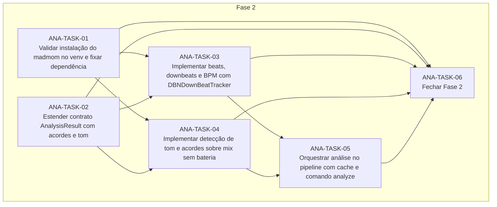

# Progress — analise-musical

## Scope

<!-- What this cycle delivers, in two or three sentences. -->

## Dependency graph

<!-- Generated from each task's depends_on; prose explaining the order goes below the region. -->
<!-- rite:begin graph -->

<!-- rite:end -->

## Tasks

<!-- rite:begin tasks -->
| ID | Title | Phase | Type | Depends on | Status | Done on | Reviewed on | Review |
| --- | --- | --- | --- | --- | --- | --- | --- | --- |
| [ANA-TASK-01](/docs/rite/cycles/analise-musical/01-validar-instalacao-do-madmom-no-venv-e-fixar.md) | Validar instalação do madmom no venv e fixar dependência | 2 | tool | — | done | 2026-10-26 | 2026-10-26 | changes |
| [ANA-TASK-02](/docs/rite/cycles/analise-musical/02-estender-contrato-analysisresult-com-acordes-e.md) | Estender contrato AnalysisResult com acordes e tom | 2 | feature | — | done | 2026-10-26 | pending | in review |
| [ANA-TASK-03](/docs/rite/cycles/analise-musical/03-implementar-beats-downbeats-e-bpm-com.md) | Implementar beats, downbeats e BPM com DBNDownBeatTracker | 2 | feature | ANA-TASK-01, ANA-TASK-02 | pending | — | — | — |
| [ANA-TASK-04](/docs/rite/cycles/analise-musical/04-implementar-deteccao-de-tom-e-acordes-sobre-mix.md) | Implementar detecção de tom e acordes sobre mix sem bateria | 2 | feature | ANA-TASK-01, ANA-TASK-02 | pending | — | — | — |
| [ANA-TASK-05](/docs/rite/cycles/analise-musical/05-orquestrar-analise-no-pipeline-com-cache-e.md) | Orquestrar análise no pipeline com cache e comando analyze | 2 | feature | ANA-TASK-03, ANA-TASK-04 | pending | — | — | — |
| [ANA-TASK-06](/docs/rite/cycles/analise-musical/06-fechar-fase-2.md) | Fechar Fase 2 | 2 | closing | ANA-TASK-01, ANA-TASK-02, ANA-TASK-03, ANA-TASK-04, ANA-TASK-05 | pending | — | — | — |
<!-- rite:end -->

## Notes
