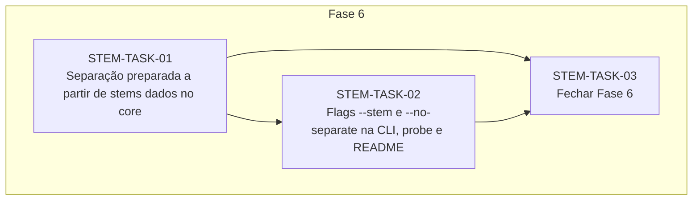

# Progress — entrada-stems

## Scope

<!-- What this cycle delivers, in two or three sentences. -->

## Dependency graph

<!-- Generated from each task's depends_on; prose explaining the order goes below the region. -->
<!-- rite:begin graph -->

<!-- rite:end -->

## Tasks

<!-- rite:begin tasks -->
| ID | Title | Phase | Type | Depends on | Status | Done on | Reviewed on | Review |
| --- | --- | --- | --- | --- | --- | --- | --- | --- |
| [STEM-TASK-01](/docs/rite/cycles/entrada-stems/01-separacao-preparada-a-partir-de-stems-dados-no.md) | Separação preparada a partir de stems dados no core | 6 | feature | — | done | 2026-11-21 | 2026-11-21 | approved |
| [STEM-TASK-02](/docs/rite/cycles/entrada-stems/02-flags-stem-e-no-separate-na-cli-probe-e-readme.md) | Flags --stem e --no-separate na CLI, probe e README | 6 | feature | STEM-TASK-01 | done | 2026-11-21 | 2026-11-21 | approved |
| [STEM-TASK-03](/docs/rite/cycles/entrada-stems/03-fechar-fase-6.md) | Fechar Fase 6 | 6 | closing | STEM-TASK-01, STEM-TASK-02 | done | 2026-11-21 | pending | awaiting |
<!-- rite:end -->

## Notes
