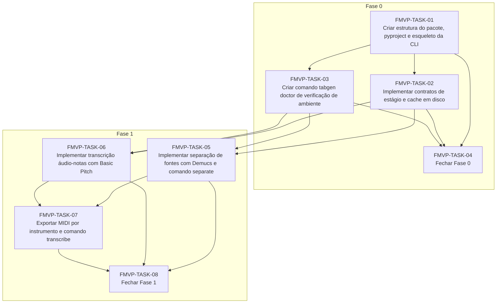

# Progress — fundacao-mvp

## Scope

<!-- What this cycle delivers, in two or three sentences. -->

## Dependency graph

<!-- Generated from each task's depends_on; prose explaining the order goes below the region. -->
<!-- rite:begin graph -->

<!-- rite:end -->

## Tasks

<!-- rite:begin tasks -->
| ID | Title | Phase | Type | Depends on | Status | Done on | Reviewed on | Review |
| --- | --- | --- | --- | --- | --- | --- | --- | --- |
| [FMVP-TASK-01](/docs/rite/cycles/fundacao-mvp/01-criar-estrutura-do-pacote-pyproject-e-esqueleto.md) | Criar estrutura do pacote, pyproject e esqueleto da CLI | 0 | feature | — | done | 2026-10-26 | 2026-10-26 | approved |
| [FMVP-TASK-02](/docs/rite/cycles/fundacao-mvp/02-implementar-contratos-de-estagio-e-cache-em.md) | Implementar contratos de estágio e cache em disco | 0 | feature | FMVP-TASK-01 | done | 2026-10-26 | 2026-10-26 | approved |
| [FMVP-TASK-03](/docs/rite/cycles/fundacao-mvp/03-criar-comando-tabgen-doctor-de-verificacao-de.md) | Criar comando tabgen doctor de verificação de ambiente | 0 | tool | FMVP-TASK-01 | done | 2026-10-26 | 2026-10-26 | approved |
| [FMVP-TASK-04](/docs/rite/cycles/fundacao-mvp/04-fechar-fase-0.md) | Fechar Fase 0 | 0 | closing | FMVP-TASK-01, FMVP-TASK-02, FMVP-TASK-03 | done | 2026-10-26 | 2026-10-26 | approved |
| [FMVP-TASK-05](/docs/rite/cycles/fundacao-mvp/05-implementar-separacao-de-fontes-com-demucs-e.md) | Implementar separação de fontes com Demucs e comando separate | 1 | feature | FMVP-TASK-02, FMVP-TASK-03 | done | 2026-10-26 | 2026-10-26 | approved |
| [FMVP-TASK-06](/docs/rite/cycles/fundacao-mvp/06-implementar-transcricao-audio-notas-com-basic.md) | Implementar transcrição áudio-notas com Basic Pitch | 1 | feature | FMVP-TASK-02, FMVP-TASK-03 | done | 2026-10-26 | 2026-10-26 | approved |
| [FMVP-TASK-07](/docs/rite/cycles/fundacao-mvp/07-exportar-midi-por-instrumento-e-comando.md) | Exportar MIDI por instrumento e comando transcribe | 1 | feature | FMVP-TASK-05, FMVP-TASK-06 | done | 2026-10-26 | 2026-10-26 | changes |
| [FMVP-TASK-08](/docs/rite/cycles/fundacao-mvp/08-fechar-fase-1.md) | Fechar Fase 1 | 1 | closing | FMVP-TASK-05, FMVP-TASK-06, FMVP-TASK-07 | blocked | — | — | — |
<!-- rite:end -->

## Notes
