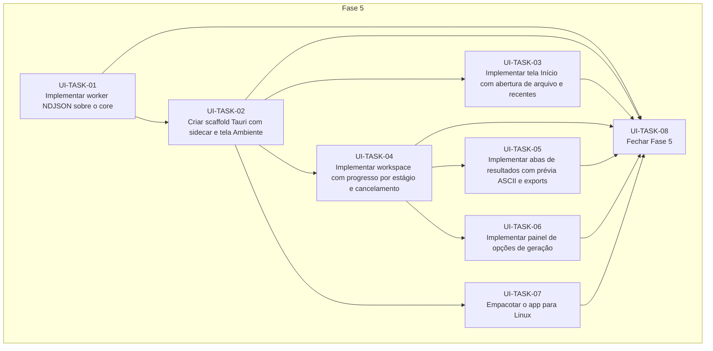

# Progress — interface-desktop

## Scope

<!-- What this cycle delivers, in two or three sentences. -->

## Dependency graph

<!-- Generated from each task's depends_on; prose explaining the order goes below the region. -->
<!-- rite:begin graph -->

<!-- rite:end -->

## Tasks

<!-- rite:begin tasks -->
| ID | Title | Phase | Type | Depends on | Status | Done on | Reviewed on | Review |
| --- | --- | --- | --- | --- | --- | --- | --- | --- |
| [UI-TASK-01](/docs/rite/cycles/interface-desktop/01-implementar-worker-ndjson-sobre-o-core.md) | Implementar worker NDJSON sobre o core | 5 | feature | — | done | 2026-10-28 | 2026-10-28 | approved |
| [UI-TASK-02](/docs/rite/cycles/interface-desktop/02-criar-scaffold-tauri-com-sidecar-e-tela-ambiente.md) | Criar scaffold Tauri com sidecar e tela Ambiente | 5 | feature | UI-TASK-01 | done | 2026-10-28 | 2026-10-28 | approved |
| [UI-TASK-03](/docs/rite/cycles/interface-desktop/03-implementar-tela-inicio-com-abertura-de-arquivo.md) | Implementar tela Início com abertura de arquivo e recentes | 5 | feature | UI-TASK-02 | done | 2026-10-28 | 2026-10-28 | approved |
| [UI-TASK-04](/docs/rite/cycles/interface-desktop/04-implementar-workspace-com-progresso-por-estagio.md) | Implementar workspace com progresso por estágio e cancelamento | 5 | feature | UI-TASK-02 | done | 2026-10-28 | 2026-10-29 | approved |
| [UI-TASK-05](/docs/rite/cycles/interface-desktop/05-implementar-abas-de-resultados-com-previa-ascii.md) | Implementar abas de resultados com prévia ASCII e exports | 5 | feature | UI-TASK-04 | done | 2026-10-29 | 2026-10-29 | approved |
| [UI-TASK-06](/docs/rite/cycles/interface-desktop/06-implementar-painel-de-opcoes-de-geracao.md) | Implementar painel de opções de geração | 5 | feature | UI-TASK-04 | done | 2026-10-29 | 2026-10-29 | approved |
| [UI-TASK-07](/docs/rite/cycles/interface-desktop/07-empacotar-o-app-para-linux.md) | Empacotar o app para Linux | 5 | tool | UI-TASK-02 | done | 2026-10-29 | pending | awaiting |
| [UI-TASK-08](/docs/rite/cycles/interface-desktop/08-fechar-fase-5.md) | Fechar Fase 5 | 5 | closing | UI-TASK-01, UI-TASK-02, UI-TASK-03, UI-TASK-04, UI-TASK-05, UI-TASK-06, UI-TASK-07 | pending | — | — | — |
<!-- rite:end -->

## Notes
