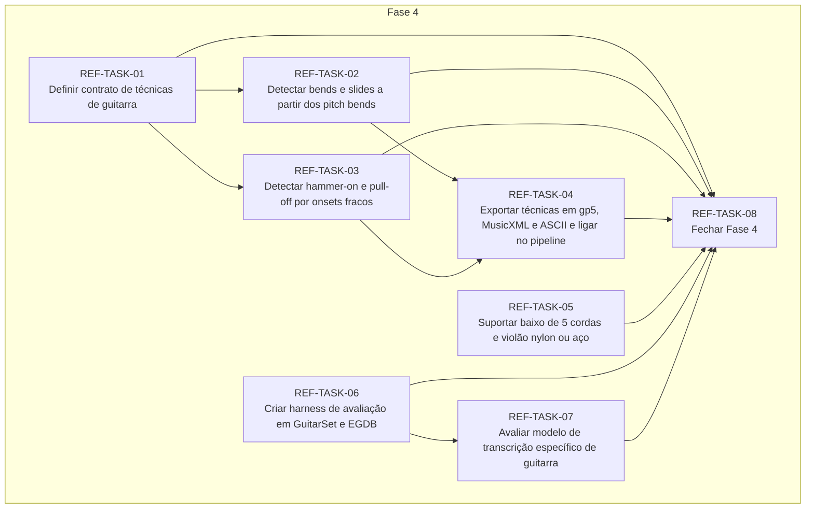

# Progress — refinamento

## Scope

<!-- What this cycle delivers, in two or three sentences. -->

## Dependency graph

<!-- Generated from each task's depends_on; prose explaining the order goes below the region. -->
<!-- rite:begin graph -->

<!-- rite:end -->

## Tasks

<!-- rite:begin tasks -->
| ID | Title | Phase | Type | Depends on | Status | Done on | Reviewed on | Review |
| --- | --- | --- | --- | --- | --- | --- | --- | --- |
| [REF-TASK-01](/docs/rite/cycles/refinamento/01-definir-contrato-de-tecnicas-de-guitarra.md) | Definir contrato de técnicas de guitarra | 4 | feature | — | done | 2026-10-27 | 2026-10-27 | approved |
| [REF-TASK-02](/docs/rite/cycles/refinamento/02-detectar-bends-e-slides-a-partir-dos-pitch-bends.md) | Detectar bends e slides a partir dos pitch bends | 4 | feature | REF-TASK-01 | done | 2026-10-27 | 2026-10-27 | approved |
| [REF-TASK-03](/docs/rite/cycles/refinamento/03-detectar-hammer-on-e-pull-off-por-onsets-fracos.md) | Detectar hammer-on e pull-off por onsets fracos | 4 | feature | REF-TASK-01 | done | 2026-10-27 | 2026-10-27 | approved |
| [REF-TASK-04](/docs/rite/cycles/refinamento/04-exportar-tecnicas-em-gp5-musicxml-e-ascii-e.md) | Exportar técnicas em gp5, MusicXML e ASCII e ligar no pipeline | 4 | feature | REF-TASK-02, REF-TASK-03 | done | 2026-10-28 | 2026-10-28 | approved |
| [REF-TASK-05](/docs/rite/cycles/refinamento/05-suportar-baixo-de-5-cordas-e-violao-nylon-ou-aco.md) | Suportar baixo de 5 cordas e violão nylon ou aço | 4 | feature | — | done | 2026-10-28 | 2026-10-28 | approved |
| [REF-TASK-06](/docs/rite/cycles/refinamento/06-criar-harness-de-avaliacao-em-guitarset-e-egdb.md) | Criar harness de avaliação em GuitarSet e EGDB | 4 | tool | — | done | 2026-10-28 | 2026-10-28 | approved |
| [REF-TASK-07](/docs/rite/cycles/refinamento/07-avaliar-modelo-de-transcricao-especifico-de.md) | Avaliar modelo de transcrição específico de guitarra | 4 | research | REF-TASK-06 | done | 2026-10-28 | pending | awaiting |
| [REF-TASK-08](/docs/rite/cycles/refinamento/08-fechar-fase-4.md) | Fechar Fase 4 | 4 | closing | REF-TASK-01, REF-TASK-02, REF-TASK-03, REF-TASK-04, REF-TASK-05, REF-TASK-06, REF-TASK-07 | pending | — | — | — |
<!-- rite:end -->

## Notes
