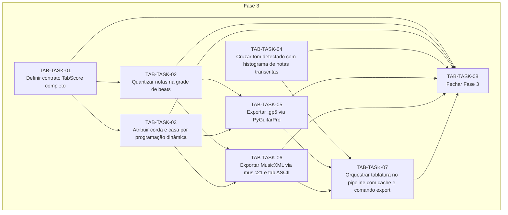

# Progress — tablatura

## Scope

<!-- What this cycle delivers, in two or three sentences. -->

## Dependency graph

<!-- Generated from each task's depends_on; prose explaining the order goes below the region. -->
<!-- rite:begin graph -->

<!-- rite:end -->

## Tasks

<!-- rite:begin tasks -->
| ID | Title | Phase | Type | Depends on | Status | Done on | Reviewed on | Review |
| --- | --- | --- | --- | --- | --- | --- | --- | --- |
| [TAB-TASK-01](/docs/rite/cycles/tablatura/01-definir-contrato-tabscore-completo.md) | Definir contrato TabScore completo | 3 | feature | — | done | 2026-10-27 | 2026-10-27 | changes |
| [TAB-TASK-02](/docs/rite/cycles/tablatura/02-quantizar-notas-na-grade-de-beats.md) | Quantizar notas na grade de beats | 3 | feature | TAB-TASK-01 | done | 2026-10-27 | 2026-10-27 | approved |
| [TAB-TASK-03](/docs/rite/cycles/tablatura/03-atribuir-corda-e-casa-por-programacao-dinamica.md) | Atribuir corda e casa por programação dinâmica | 3 | feature | TAB-TASK-01 | done | 2026-10-27 | pending | in review |
| [TAB-TASK-04](/docs/rite/cycles/tablatura/04-cruzar-tom-detectado-com-histograma-de-notas.md) | Cruzar tom detectado com histograma de notas transcritas | 3 | feature | — | done | 2026-10-27 | pending | in review |
| [TAB-TASK-05](/docs/rite/cycles/tablatura/05-exportar-gp5-via-pyguitarpro.md) | Exportar .gp5 via PyGuitarPro | 3 | feature | TAB-TASK-02, TAB-TASK-03 | pending | — | — | — |
| [TAB-TASK-06](/docs/rite/cycles/tablatura/06-exportar-musicxml-via-music21-e-tab-ascii.md) | Exportar MusicXML via music21 e tab ASCII | 3 | feature | TAB-TASK-02, TAB-TASK-03 | pending | — | — | — |
| [TAB-TASK-07](/docs/rite/cycles/tablatura/07-orquestrar-tablatura-no-pipeline-com-cache-e.md) | Orquestrar tablatura no pipeline com cache e comando export | 3 | feature | TAB-TASK-04, TAB-TASK-05, TAB-TASK-06 | pending | — | — | — |
| [TAB-TASK-08](/docs/rite/cycles/tablatura/08-fechar-fase-3.md) | Fechar Fase 3 | 3 | closing | TAB-TASK-01, TAB-TASK-02, TAB-TASK-03, TAB-TASK-04, TAB-TASK-05, TAB-TASK-06, TAB-TASK-07 | pending | — | — | — |
<!-- rite:end -->

## Notes
